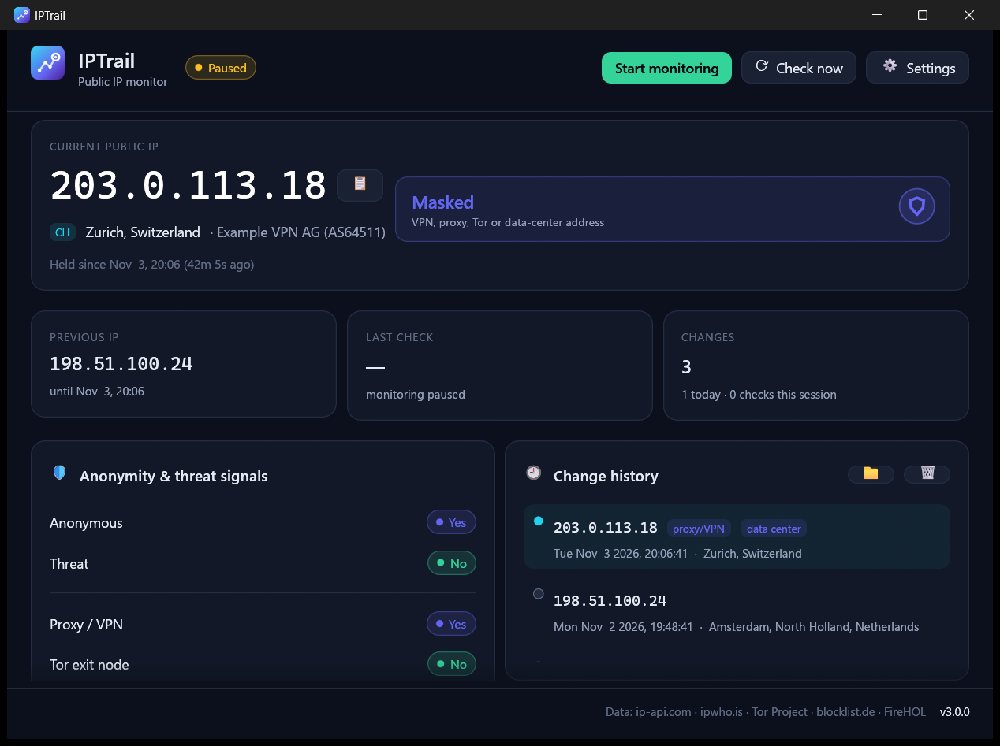

<div align="center">


# IPTrail

**Know every hop your public IP takes. Made by Akulav.**

No spyware. No telemetry. No API keys. One file per system that installs and updates itself.

[](https://github.com/Akulav/ip-change-logger/releases/latest)
[](https://github.com/Akulav/ip-change-logger/releases)
[](https://github.com/Akulav/ip-change-logger/actions/workflows/build.yml)


### [⬇ Download the latest release](https://github.com/Akulav/ip-change-logger/releases/latest)



</div>

---

## ⬇️ Download

One file per system. The same file installs the app the first time and updates it later.

| Platform | File | Notes |
| :-- | :-- | :-- |
| 🪟 **Windows 10 / 11** (x64) | [`IPTrail-setup.exe`](https://github.com/Akulav/ip-change-logger/releases/latest/download/IPTrail-setup.exe) | Asks where to install. No admin rights needed. Includes `iptrail-cli.exe` for terminals. |
| 🐧 **Linux** (x64) | [`IPTrail-linux-x64`](https://github.com/Akulav/ip-change-logger/releases/latest/download/IPTrail-linux-x64) | glibc 2.35+ (Ubuntu 22.04 or newer), X11 or Wayland |
| 🍎 **macOS** (Apple Silicon) | [`IPTrail-macos-arm64`](https://github.com/Akulav/ip-change-logger/releases/latest/download/IPTrail-macos-arm64) | macOS 12+ |

Every release also ships `SHA256SUMS.txt` so you can verify your download.

## ✨ Features

<table>
<tr>
<td width="50%" valign="top">

### 🛰️ Always watching
- Polls your public IP every 5 s – 1 h (default 15 s) with failover across four independent services,
  so one outage never looks like a change.
- A **desktop notification** the moment your address changes.

</td>
<td width="50%" valign="top">

### 🧾 A real trail
- Every change saved with time, previous address, location and flags: in the app, in `history.jsonl`
  and in a plain-text log you can `grep`.
- Double-click an entry to copy it; one click opens the log folder.

</td>
</tr>
<tr>
<td width="50%" valign="top">

### 🛡️ Anonymity & threat signals
- Proxy/VPN, Tor exit node, data center, mobile network, known attacker and known abuser,
  rolled up into one **Clean / Masked / Flagged** verdict.
- Free, keyless sources only: nothing to sign up for.

</td>
<td width="50%" valign="top">

### 🔄 Always up to date
- **You choose the install folder** once; the app and everything it saves live there.
- **One-click updates** from GitHub, verified with SHA-256, into the same folder.
- A single native Rust binary; tray icon on Windows, headless mode for servers.

</td>
</tr>
</table>

## 🚀 Getting started

### Windows
1. Download **`IPTrail-setup.exe`** and run it.
2. Pick the install folder (default `%LOCALAPPDATA%\Programs\IPTrail`, any folder you can write to works,
   e.g. `D:\Apps\IPTrail`). It adds Start-menu and (optional) Desktop shortcuts and an entry in *Settings → Apps*.
3. Updates install into the same folder without asking: in-app with one click, or by running a newer setup.

Uninstall from *Settings → Apps*. The uninstaller asks whether to keep your settings, history and log.

> [!NOTE]
> Windows SmartScreen may warn about an unrecognised app because the setup is not code-signed. Choose
> **More info → Run anyway**, or build from source.

### Linux
```bash
chmod +x IPTrail-linux-x64
./IPTrail-linux-x64
```
It asks for an install folder (default `~/.local/share/IPTrail`), copies itself there and adds an app-menu entry with
icon and an `iptrail` terminal command. *Just run it* skips installing. Running a newer download later offers to update
the installed copy in its folder. Uninstall with `iptrail --uninstall`.

### macOS (Apple Silicon)
```bash
chmod +x IPTrail-macos-arm64
xattr -d com.apple.quarantine IPTrail-macos-arm64
./IPTrail-macos-arm64
```
It asks for an install folder (default `~/Applications/IPTrail`) and creates `IPTrail.app` there.

> 💡 Want it portable? Put an empty `portable.txt` next to the program (or start it with `--portable`): it then keeps
> its data next to itself and never offers to install.

## 📁 Where your data lives

**In the install folder you chose**, next to the program. Nothing goes to `%APPDATA%`, `~/.config`, `~/.local/share`
or `~/.cache`. The folder is remembered (Windows: by the setup; Linux/macOS: in `~/.config/iptrail/install-dir` or
`~/Library/Application Support/iptrail/install-dir`), so updates keep everything in place. Settings, history and the
log from IPTrail 3.0 are moved in on the first start, also when the install folder is on another drive.

| Path | Contents |
| :-- | :-- |
| `settings.json` | settings |
| `history.jsonl` | every change, machine-readable |
| `ip-changes.log` | every change, one line each (can be moved anywhere in Settings) |
| `cache/` | downloaded Tor / abuse block lists |
| `update/` | a downloaded update while it is being applied |
| `.iptrail-install` | marks the install folder (holds the installed version) |

Run `iptrail --paths` to see the exact locations; set `IPTRAIL_DATA_DIR` to use a different data folder. A log line
looks like this:

```text
2026-11-03 20:06:41 +01:00  203.0.113.18     (was 198.51.100.24)  Zurich, Switzerland  · Example VPN AG (AS64511)  [proxy/VPN, data center]
```

## 🖥️ Command line

On Windows, use `iptrail-cli.exe` (installed next to the app) from a terminal: it is the same program built as a
console app. On Linux and macOS, `iptrail` does both.

| Flag | Meaning |
| :-- | :-- |
| `--once` | Print the current IP with location and signals, then exit |
| `--headless` | Monitor in the terminal, printing each change |
| `--interval <secs>` | Override the check interval for this run (5–3600 s) |
| `--no-intel`, `--no-feeds` | Skip lookups / blocklists for this run |
| `--paths` | Show where settings, history and logs live |
| `--demo` | Open the app with sample data (offline) |
| `--here` | Run without offering to install (Linux/macOS) |
| `--portable` | Keep data next to the program, never install |
| `--uninstall` | Remove the installed app (Windows: starts the uninstaller) |
| `--version` | Print the version and exit |

## 🔒 Data sources & privacy

IPTrail only talks to the services below, and only to ask about **your own** public address (plus GitHub, to check
for updates). There is no telemetry.

| Purpose | Service | Notes |
| :-- | :-- | :-- |
| Public IP | [ipify](https://www.ipify.org), [icanhazip](https://icanhazip.com), [AWS checkip](https://checkip.amazonaws.com), [ident.me](https://ident.me) | HTTPS, tried in order |
| Location, ISP, proxy/hosting/mobile | [ip-api.com](https://ip-api.com) | Free tier is **HTTP only**, 45 req/min, non-commercial |
| Fallback location | [ipwho.is](https://ipwho.is) | HTTPS |
| Tor exit nodes | [Tor Project bulk exit list](https://check.torproject.org/torbulkexitlist) | Cached 1 h |
| Known attackers | [blocklist.de](https://www.blocklist.de) | Reports from the last 48 h, cached 6 h |
| Known abusers | [FireHOL level 1](https://iplists.firehol.org/?ipset=firehol_level1) | Cached 12 h |

Lookups run only when your address changes, and either source can be switched off in Settings. Details in
[docs/data-sources.md](docs/data-sources.md).

<details>
<summary><b>🛠️ For maintainers: updates, releases and building</b></summary>

### Publishing a release

Releases are fully automated by [`.github/workflows/build.yml`](.github/workflows/build.yml):

1. Bump `version` in `Cargo.toml` and add its section to [`CHANGELOG.md`](CHANGELOG.md).
2. Push to `main`.
3. If no release with that version exists, CI checks formatting and Clippy, tests and builds all three systems, tags
   the commit `vX.Y.Z` and publishes a GitHub release with exactly three programs, `IPTrail-setup.exe`,
   `IPTrail-linux-x64` and `IPTrail-macos-arm64`, plus `SHA256SUMS.txt`. The notes come from the changelog.
4. Installed copies find the release on GitHub by themselves (10 seconds after start and every 6 hours, or with
   *Check for updates* in the footer).

### How updates are applied

*Update* downloads this system's file into the install folder (`update/`) and checks that it is a program for this
system and matches `SHA256SUMS.txt`; *Restart & update* then

- **Windows:** runs `IPTrail-setup.exe /VERYSILENT /UPDATE` with the current install folder. The setup closes the app,
  installs into the same folder and starts the new version.
- **Linux / macOS:** swaps the binary in the install folder in place (re-signing the app on macOS) and restarts.

### Building from source

Requires [Rust](https://rustup.rs) 1.95 or newer.

```bash
cargo build --release
```

The programs land in `target/release/` (`iptrail`, `iptrail-cli` on Windows). On Linux you may need
`libxkbcommon-dev libwayland-dev libfontconfig1-dev` (see [docs/development.md](docs/development.md)). The Windows setup
needs [Inno Setup 6](https://jrsoftware.org/isinfo.php):

```bash
iscc /DAppVersion=3.1.0 /DSourceDir=%CD%\target\release installer\iptrail.iss
```

It writes `dist\IPTrail-setup.exe`. Debug builds never offer to install themselves (pass `--here` to a release build
for the same). `cargo test` runs the unit tests. More in [docs/](docs/architecture.md).

### Upgrading from IPLogger 2.x

IPTrail 3 replaced the old C# IPLogger. The ipdata.co key and `key.txt` are no longer needed. Your old `ip.txt` on the
desktop is left untouched; new changes go to `ip-changes.log` (or any path you choose in Settings).

</details>

## 🙏 Credits

Data from ip-api.com, ipwho.is, the Tor Project, blocklist.de and FireHOL; each keeps its own terms.

---

<div align="center">

**Made with ❤️ by [Akulav](https://github.com/Akulav)**

<sub>© 2026 Akulav. Source-available under the <a href="LICENSE">Akulav Source-Available License</a>.</sub>

</div>
